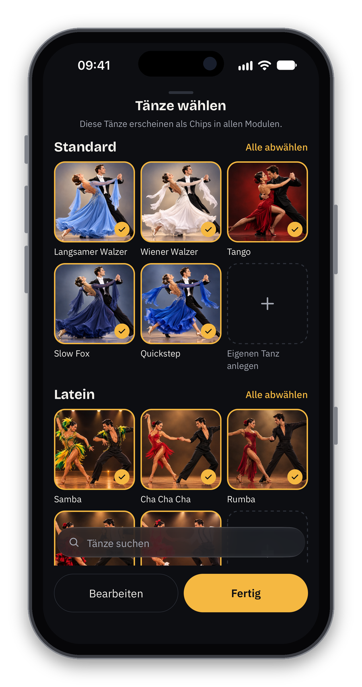
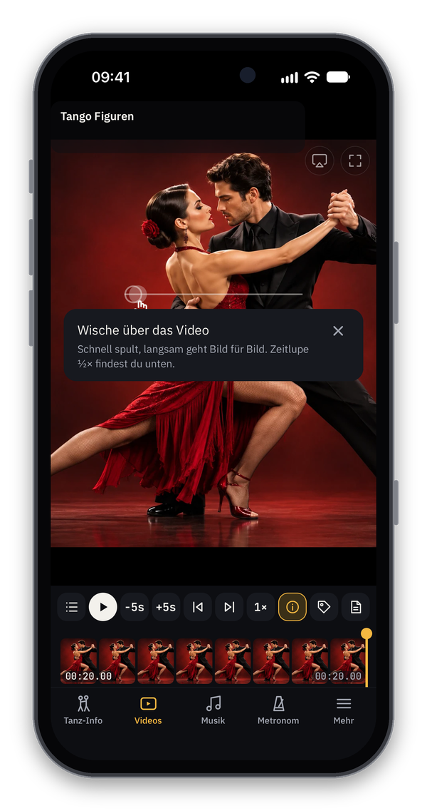
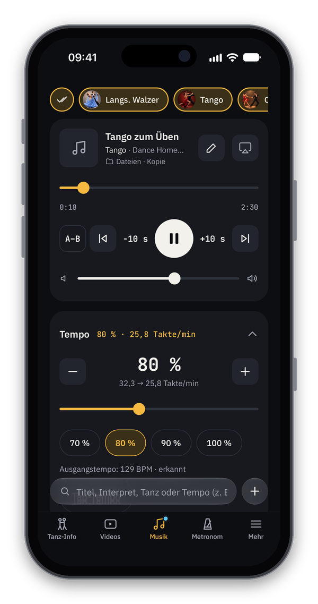
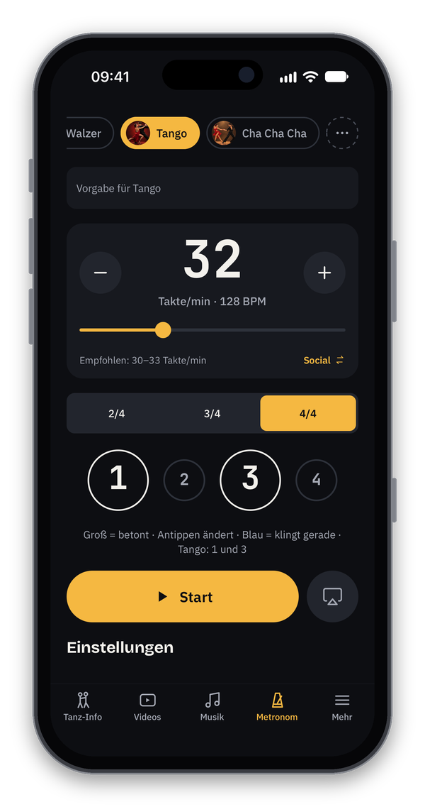
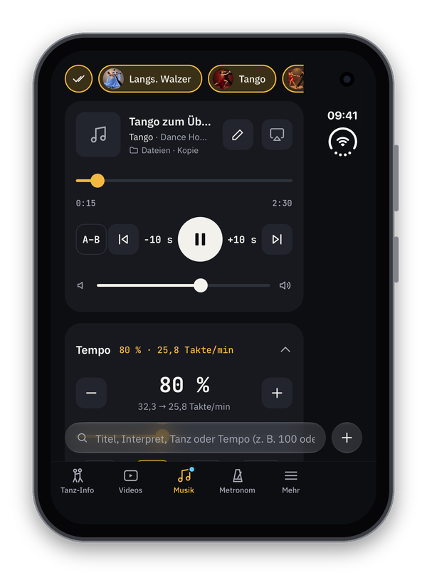
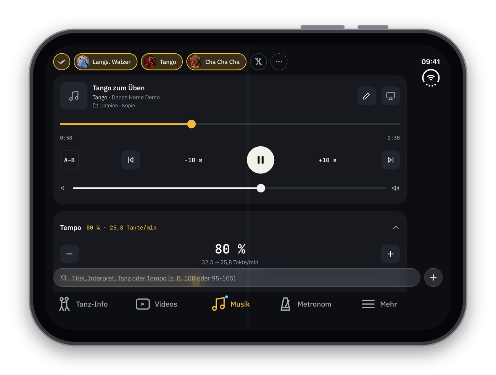

# Dance Home

**Tanzvideos und Musik an einem Ort** – eine App zum Üben von Gesellschaftstänzen, entstanden aus einem Tanzhobby.

Dance Home ist kostenlos und bleibt kostenlos. Es gibt keine bezahlte Werbung, keine In-App-Käufe, kein Benutzerkonto und kein Tracking. Deine Videos, deine Musik und deine Notizen bleiben auf deinem Gerät.

> Status: Dance Home wird derzeit getestet und ist noch nicht im App Store. Diese Seite beschreibt nur Funktionen, die bereits in der App umgesetzt sind.

<table>
<tr>
<td align="center"> Tanzauswahl</td>
<td align="center"> Videos: Wischen zum Spulen</td>
<td align="center"> Musik langsamer abspielen</td>
<td align="center"> Metronom</td>
</tr>
</table>

&nbsp;&nbsp;
 
iPhone Duo: zugeklappt 2 Spalten, aufgeklappt 4 Spalten Videos

## Was Dance Home kann

### Tänze im Mittelpunkt
- **21 Tänze:** die 10 Turniertänze (Standard und Latein, Tempo nach WDSF) und 11 Social-Tänze wie Discofox, Salsa, Bachata, Swing oder Rock’n’Roll – jeweils mit Foto oder Symbolbild, Taktart, Tempo, Betonung und Beschreibung.
- **Tanz-Info:** Rhythmus zum Anhören, Charakter, Geschichte und Quellen zu jedem Tanz; eigene Tänze lassen sich anlegen.
- **Tanzauswahl:** Wähle deine Tänze als Chips; Videos und Musik richten sich nach dem aktiven Tanz.

### Videos
- Eigene Videos in die App übernehmen (aus Fotos, per „Teilen“ oder direkt filmen) – die Originale bleiben unverändert.
- **Präzise Analyse:** Wische über das Video, um zu spulen – schnell spult, langsam geht Bild für Bild; dazu Zeitlupe ½×, Filmstreifen und schnelle Tasten. Beim ersten Mal zeigt die App eine kleine Hilfe dazu.
- Titel, Stichworte, Tanz und **Notizen** zu jedem Video.
- **Direkt aufnehmen** mit den Zoom-Stufen der Kamera-App; das Video landet sofort beim gewählten Tanz.

### Musik
- **Deine MP3-Musik langsamer machen, ohne dass sie tiefer klingt:** 70 %, 80 %, 90 % oder ein Zieltempo in Takten pro Minute – ideal zum Einüben neuer Figuren. Dazu Playlisten, A–B-Schleife und Suche nach Tempo.
- Für Übungen ohne Musik gibt es ein Metronom im Tempo des Tanzes.

### Überall dabei
- **Sprachsteuerung** (auf Android nicht verfügbar): „Spiele Walzer in Dance Home“ mit Siri.
- **Handoff** (nur iPhone, iPad und Mac): Video oder Musik am einen Gerät starten und am anderen an derselben Stelle weitermachen – mit eingeschaltetem iCloud-Sync auch mit deinen eigenen Videos und Titeln.
- **Tonausgabe:** über AirPlay, Bluetooth oder das Gerät.
- **iCloud-Sync** (nur iPhone, iPad und Mac; optional, ab Werk aus): deine Bibliothek auf allen eigenen Geräten.
- **Tanzkreise** (nur iPhone, iPad und Mac): Videos, Musik und Notizen über iCloud mit Personen teilen, die du selbst einlädst. Jede Person gründet höchstens einen eigenen Tanzkreis mit bis zu 6 Personen (sie selbst eingeschlossen); bei anderen mitmachen geht beliebig oft. Auf Android gibt es die Tanzkreise aus technischen Gründen vorerst nicht.
- **Plattformen:** iPhone, iPad, Android und Mac.
- Deutsch und Englisch, heller und dunkler Farbstil.

## Datenschutz

Dance Home speichert alles auf deinem Gerät – ohne Konto, ohne Server, ohne Tracking. iCloud-Sync ist freiwillig und ab Werk aus. Was in deiner iCloud liegt, bleibt dort auch, wenn du die App löschst – freigeben kannst du den Platz vorher in der App (iCloud & Sicherung › „iCloud-Daten löschen“, eigener Tanzkreis unter Tanzkreise) oder in den iCloud-Einstellungen deines Geräts (Speicher verwalten › Dance Home). Vor dem ersten Start bestätigst du die Datenschutzerklärung; sie lässt sich in der App auch ohne Internet lesen.

- [Datenschutzerklärung](privacy.md)
- [Impressum](impressum.md)

## Quellen und Lizenzen

- **Tanzbeschreibungen:** in eigenen Worten verfasst auf Grundlage der deutschen und englischen Wikipedia und des Regelwerks der World DanceSport Federation (WDSF); die Quellen stehen je Tanz in der App.
- **Tanzbilder:** KI-generiert.
- Alle Open-Source-Bausteine und Schriften mit ihren Lizenzen: in der App unter Mehr › Über & Lizenzen.

## Kontakt

Michael Geramb · DanceHome@icloud.com

---

Die Tanzbilder in der App und auf dieser Seite sind KI-generiert.

[English version](en/README.md)
