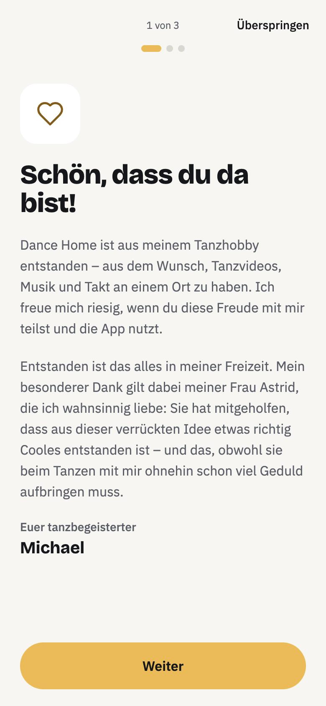
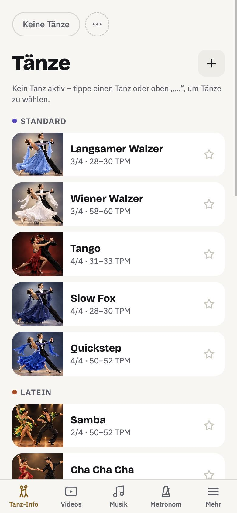
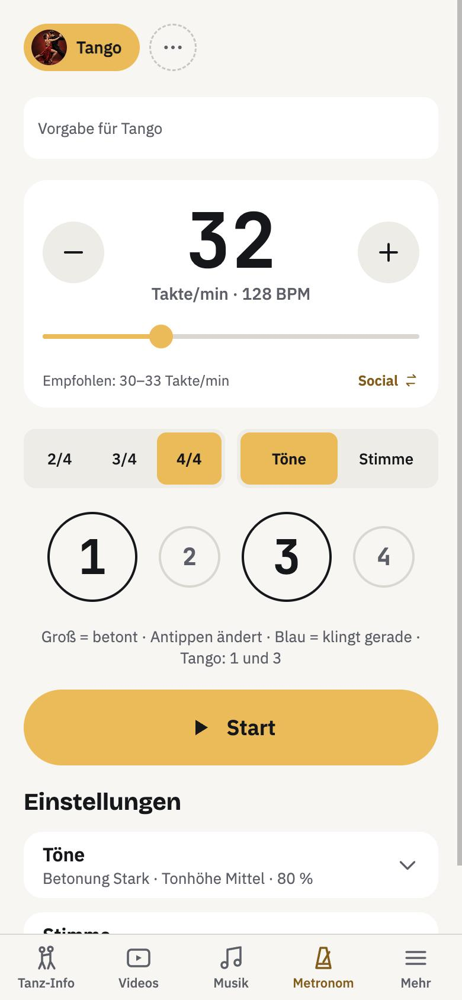
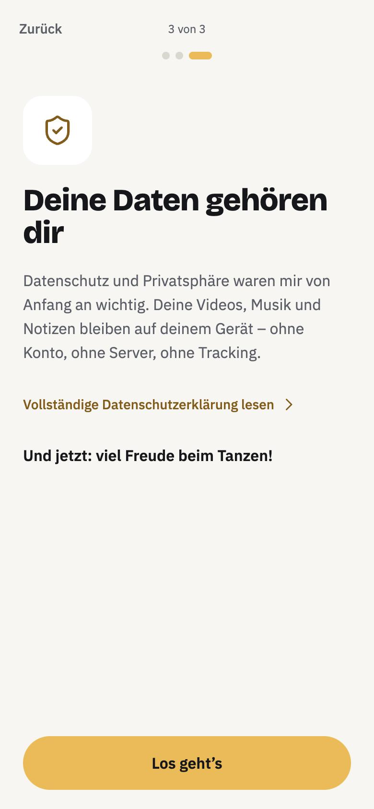
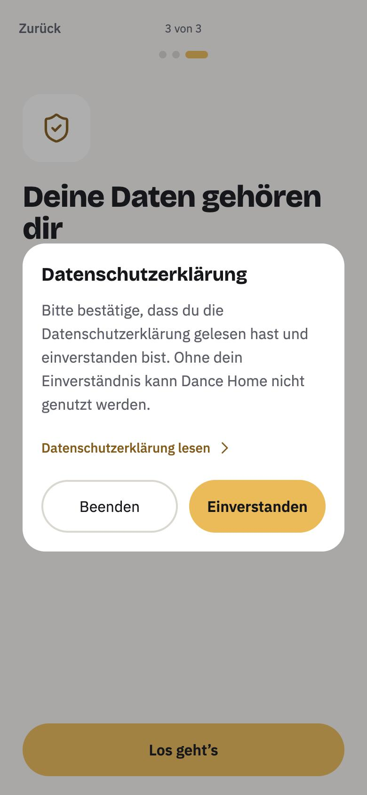

# Dance Home

**Dance videos, music and beat in one place** – an app for practising ballroom and social dances, born out of a dancing hobby.

Dance Home is free and will remain free. There is no paid advertising, no in-app purchases, no account and no tracking. Your videos, music and notes stay on your device.

> Status: Dance Home is currently being tested and is not yet in the App Store. This page only describes features that are already implemented in the app.

_The screenshots show the German version._

## What Dance Home can do

### Dances at the centre
- **19 dances:** the 10 competition dances (Standard and Latin, tempo per WDSF) and 9 social dances such as Discofox, Salsa, Bachata or Lindy Hop – each with photo, time signature, tempo, accents and description.
- **Dance info:** listen to the rhythm, read about character, history and sources of every dance; you can add your own dances.
- **Dance selection:** pick your dances as chips; videos, music and metronome follow the active dance.

### Videos
- Bring your own videos into the app (from Photos, via “Share”, or film directly) – the originals stay untouched.
- **Precise analysis:** swipe-scrubbing down to a single frame, filmstrip, quick keys.
- Title, keywords, dance and **notes** for every video.
- **Record in the app** with the zoom steps of the camera app; the video lands with the chosen dance right away.

### Metronome
- Tempo and time signature of the dance are preset, accents can be tapped.
- A clearly audible one, tones or **counting by voice**; keeps running in the background.

### Music
- Your own files, music library and (experimental) Apple Music.
- **Change the tempo without changing the pitch** – in percent or in bars per minute; playlists, A–B loop and search by tempo.
- **Beat counter:** counts the beat of the music that is playing, live.

### Everywhere
- **Voice control:** “Play waltz in Dance Home” with Siri or the Android assistant.
- **Sound output:** via AirPlay, Bluetooth or the device.
- **iCloud sync** (optional, off by default) and **sharing with the family** on iPhone, iPad and Mac.
- **Platforms:** iPhone, iPad, Android, Mac and Windows (as an installable web app).
- German and English, light and dark style.

## Privacy

Dance Home keeps everything on your device – no account, no server, no tracking. iCloud sync is optional and off by default. Before first use you confirm the privacy policy; it can also be read in the app without internet.

- [Privacy policy](privacy.md)
- [Legal notice](impressum.md)

## Contact

Michael Geramb · DanceHome@icloud.com

---

[Deutsche Version](../index.md)
